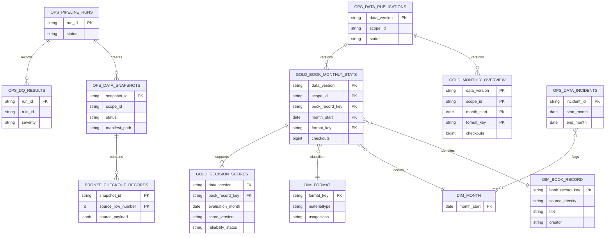

# ERD logic tổng quan

Grain, khóa và quan hệ logic Silver được chốt tại
[Silver Data Contract](silver_contract.md); sơ đồ dưới đây thể hiện các lớp
Gold/DS ở mức tổng quan và chưa phải DDL.

Theo mục 5 của [BookScope.pdf](BookScope.pdf). Grain Silver đã chốt.
Profile identity đã hoàn tất ngày 04/11/2026; [Gold Data Contract và ERD](gold_contract.md)
là hợp đồng hiện hành cho khóa tuple cohort, bảng Gold, FK và publication.
DDL thực tế nằm ở `sql/gold/001_publications.sql`, kết quả ở
[nghiệm thu G3](gold_g3_acceptance_2026-11-04.md).
Sơ đồ tổng quan bên dưới chỉ giữ vai trò bối cảnh kiến trúc.

`silver.overview_groups`, `silver.detail_records`, `silver.quarantine_records`
và `silver.snapshot_quality` nằm giữa Bronze và Gold. Chưa vẽ quan hệ FK
cho `book_record_key` trong sơ đồ cũ. Quan hệ FK và identity version đã được
chốt ở [Gold Data Contract](gold_contract.md). Sơ đồ trên không phải DDL để
chạy trực tiếp.
