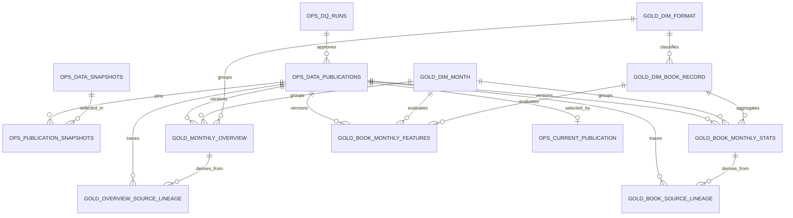

# Gold Data Contract, logical schema và publication — v1_2026_11_04

Trạng thái: **đã triển khai và công bố qua `gold_analytics_marts`**.
Physical schema nằm tại `sql/gold/001_publications.sql`; dbt tạo model trong
schema staging riêng, Python runner kiểm thử và chuyển dữ liệu vào các bảng
versioned trước khi đổi con trỏ công bố. Bằng chứng profile nằm ở
[Gold entry profiling](gold_profile_2026-11-04.md); công thức ở
[KPI Specification](gold_kpi_spec.md). Chỉ đọc hai view
`silver.dq_approved_*` và xác nhận `ops.dq_gate.status = 'PASS'` trong suốt
quy trình build/promotion. Phạm vi 2023-01–2025-12, một snapshot hiệu lực cho
mỗi `(stream, scope_id, month_start)`, 72 snapshot mỗi phiên bản.

## Grain, khóa và phép gộp

| Quan hệ logic | Grain / khóa chính | Nguồn, scope và điều kiện |
| --- | --- | --- |
| `gold.dim_month` | `month_start` | 36 tháng lịch, ngày 1; calendar spine cho KPI. |
| `gold.dim_format` | `format_key` | Chỉ `EBOOK`, `PRINT_BOOK`; không gom hai scope. |
| `gold.dim_book_record` | `book_record_key` | Một tuple cohort đã chuẩn hóa alias; giữ `identity_version`, title/creator/material/checkout type nguồn, `format_key`, `cohort_sha256`. Một khóa không phải một tác phẩm/ấn bản. |
| `gold.monthly_overview` | `(data_version, scope_id, month_start, format_key)` | `scope_id = ALL_ELIGIBLE_AGG`; `SUM(checkouts)`, `SUM(source_row_count)`, `COUNT(*)` nhóm Silver; một dòng cho mỗi tháng/format (72 dòng/phiên bản). KPI overview giữ cùng grain. |
| `gold.book_monthly_stats` | `(data_version, scope_id, book_record_key, month_start, format_key)` | `scope_id = SELECTED_DETAIL`; `SUM(checkouts)` và `COUNT(*)` dòng Silver thuộc cùng tuple/tháng. Chỉ tháng có dòng; profile hiện tại dự kiến 31.402 dòng/phiên bản. |
| `gold.book_monthly_features` | `(data_version, book_record_key, month_start)` | Calendar spine 1.000 × 36; `observed=false` và `checkouts=NULL` khi không có dòng detail, không tự sinh 0. MoM/YoY/rolling/growth có cờ bằng chứng. |
| `gold.overview_source_lineage` | `(data_version, snapshot_id, source_row_number)` | Một dòng cho mỗi nhóm Silver overview; FK logic tới fact overview, giữ checkouts/source_row_count nguồn. |
| `gold.book_source_lineage` | `(data_version, snapshot_id, source_row_number)` | Một dòng cho mỗi dòng Silver detail; FK logic tới fact book, giữ checkouts nguồn và `book_record_key`. Không dedup theo metadata. |
| `ops.data_publications` | `data_version` | Trạng thái build/publish, `dq_run_id`, source selection, contract/code/cohort hash, output digest, thời gian. |
| `ops.publication_snapshots` | `(data_version, stream, scope_id, month_start)` | 72 khóa snapshot đã chọn; FK `data_version` và `snapshot_id`. |
| `ops.current_publication` | singleton `id=1` | Con trỏ FK tới một `data_version` PUBLISHED, cập nhật nguyên tử. |
| `ops.gold_builds` | `build_id` | Lịch sử từng build, pin DQ run, trạng thái, kết quả dbt/validation, digest và lỗi. |
| `ops.gold_build_pins` | `(build_id, stream, scope_id, month_start)` | 72 snapshot/manifest cố định cho staging; không thay thế publication snapshots. |

`checkouts` và số dòng fact là số nguyên không âm; cộng bằng `numeric` khi
tính trung gian, chỉ cast sang `bigint` sau kiểm tra biên. `format_key` và
`month_start` là dimension key, không thay thế scope. `book_monthly_stats`
không có dòng khi tuple không xuất hiện trong tháng; `book_monthly_features`
đánh dấu rõ `observed=false`. `Subjects`/ISBN chỉ là metadata, không join
nhiều giá trị trước khi cộng checkouts.

Các cột tối thiểu ngoài khóa:

| Bảng | Cột bắt buộc và kiểu logic | FK cần kiểm tra |
| --- | --- | --- |
| `dim_book_record` | `identity_version text`, `title_raw text`, `creator_raw text NULL`, `materialtype_cohort text`, `checkouttype_raw text`, `format_key text`, `cohort_sha256 char(64)`, `title_display text` | `format_key → dim_format` |
| `monthly_overview` | `checkouts bigint`, `source_row_count bigint`, `source_group_count bigint`, `source_snapshot_id text`, `detail_checkouts bigint`, `active_book_records integer`, `cohort_coverage numeric NULL`, `mom_change numeric NULL`, `yoy_change numeric NULL`, `rolling_3m_sum bigint NULL`, `rolling_3m_avg numeric NULL`, `format_share numeric NULL`, `metric_status jsonb` | `data_version → data_publications`, `month_start → dim_month`, `format_key → dim_format`, snapshot → `publication_snapshots` |
| `book_monthly_stats` | `checkouts bigint`, `source_record_count bigint`, `source_snapshot_id text` | `book_record_key → dim_book_record`, month/format/publication/snapshot như trên |
| `book_monthly_features` | `format_key text`, `observed boolean`, `checkouts bigint NULL`, `rolling_3m_sum bigint NULL`, `rolling_3m_avg numeric NULL`, `mom_change numeric NULL`, `yoy_change numeric NULL`, `book_growth_3m numeric NULL`, `metric_status jsonb` | `book_record_key → dim_book_record`, `month_start → dim_month`, `data_version → data_publications` |
| Hai bảng lineage | `checkouts bigint`, `month_start date`, `format_key text`, `scope_id text`; overview thêm `source_row_count bigint`, detail thêm `book_record_key text` | FK composite đến fact cùng `data_version`, tháng, format, scope (và book key nếu detail) |
| `data_publications` | `status STAGED/PUBLISHED`, `dq_run_id uuid`, `selection_sha256 char(64)`, `cohort_sha256 char(64)`, Silver/mapping/DQ/Gold/identity versions, DQ code/config hashes, DQ source state, Gold `code_sha256`, `output_sha256`, thời gian | `dq_run_id → ops.dq_runs`; PUBLISHED bất biến bằng trigger |
| `publication_snapshots` | `snapshot_id text`, `manifest_sha256 char(64)` | `data_version → data_publications`, `snapshot_id → ops.data_snapshots` |
| `current_publication` | `data_version char(64)`, `switched_at timestamptz` | `data_version → data_publications` với status PUBLISHED |
| `gold_builds` / `gold_build_pins` | `build_id uuid`, DQ run, selection/source state, snapshot/manifest, dbt/test evidence | FK tới DQ run và Raw snapshot; dùng trong staging, có thể giữ cả run thất bại để audit |

Logical FK tới `publication_snapshots` cần unique phụ
`(data_version, stream, scope_id, month_start, snapshot_id)` nếu triển khai
FK composite ở PostgreSQL. Tất cả cột text trong identity được hash với NULL
phân biệt chuỗi rỗng; unique trên tuple dùng `NULLS NOT DISTINCT` hoặc kiểm
thử tương đương.

## `book_record_key` — identity contract

`identity_version = cohort_tuple_v1`. Khóa là 64 ký tự hex SHA-256 của UTF-8
text do PostgreSQL tạo từ:

```sql
jsonb_build_array(
  'cohort_tuple_v1', title_raw, creator_raw,
  CASE WHEN materialtype_raw = 'Ebook' THEN 'EBOOK' ELSE materialtype_raw END,
  checkouttype_raw
)::text
```

Hàm SQL: `encode(sha256(convert_to(<text_trên>, 'UTF8')), 'hex')`.
`title_raw`, `creator_raw` (kể cả NULL), `checkouttype_raw` giữ nguyên chuỗi
nguồn; chỉ alias material đã được cohort audit duyệt. Không lower/trim hoặc
gộp BOOK/REGPRINT thành PRINT_BOOK trong identity. `format_key` là thuộc tính
định dạng đi kèm và phải nhất quán với material đã map. Khóa giống nhau qua
tháng và các bản công bố dùng cùng `identity_version`; thay quy tắc identity
phải tăng version, tái profile, chạy lại toàn bộ gate. Kiểm tra mỗi hash ứng
với đúng một tuple; 1.000 tuple hiện tại tạo 1.000 hash khác nhau.

Tên `book_record_key` là tên kỹ thuật của **bản ghi cohort**. Không dùng nó
để tuyên bố hai tuple khác nhau là cùng tác phẩm, hoặc một tuple là một ấn
bản thư mục. `source_id` là khóa dòng trong snapshot, không dùng xuyên tháng.

## ERD logic



FK tới các bảng Gold cần mang `data_version` ở quan hệ fact/lineage. `dim_book_record`
giữ PK ổn định theo identity version; fact tới dimension bằng
`book_record_key`. `ops.publication_snapshots` pin nguồn để bản cũ có thể
tái lập dù lựa chọn snapshot hiện tại đã đổi.
Trigger trên ba Dimension chặn UPDATE/DELETE nếu khóa đang được bất kỳ phiên
bản PUBLISHED nào sử dụng. INSERT bản ghi mới hợp lệ vẫn được phép;
`dim_format` hiện chỉ có hai giá trị được hợp đồng chấp nhận. TRUNCATE bị chặn.
Trigger dùng cùng khóa giao dịch với publication để tránh sửa Dimension trong
lúc chuyển bản công bố.
Ba view `gold.current_monthly_overview`, `gold.current_book_monthly_stats` và
`gold.current_book_monthly_features` chỉ đọc phiên bản đang được trỏ tới.

## Validation và provenance

- Bắt buộc đúng 72 snapshot và 36 tháng × 2 format overview. Detail có thể
  vắng tuple ở một tháng; không ép đủ 36 dòng fact cho từng key.
- `monthly_overview` đối soát `checkouts`, `source_row_count` và số nhóm với
  Silver theo đúng tháng/format/scope/snapshot. `book_monthly_stats` đối soát
  checkouts và số dòng chi tiết, trước và sau gộp theo `book_record_key`.
- Mỗi dòng Silver được map đúng một lineage row; tổng lineage bằng tổng fact.
  Không được mất/nhân dòng khi nhiều source rows thuộc một tuple–tháng.
- PK/FK, material→format, `checkouts >= 0`, unique book hash/tuple, và các
  cờ `observed`/NULL của features đều là BLOCK nếu vi phạm.
- Mỗi fact gắn `data_version`; lineage giữ `snapshot_id`, `source_row_number`.
  Publication giữ mapping/Silver/Gold/DQ/identity version, cohort hash, 72
  manifest hash, source selection, code hash và output digest.

## Data versioning và publication policy

1. Build bắt đầu khi DQ gate PASS. Pin 72 snapshot ID/hash và DQ run trong
   `ops.gold_build_pins`; dbt ghi bảng vào schema `gold_stage_<build_id>`,
   không sửa bản PUBLISHED. Artifact dbt (`manifest.json`, `run_results.json`
   và log) nằm tại `dbt_bookscope/target_gold/<build_id>/`. Runner giữ khóa
   Gold build trong suốt thời gian dbt chạy, kiểm thử và publication để các
   build trên máy 8 GB thực hiện tuần tự. dbt thủ công mặc định dùng
   `gold_sandbox`.
2. Tính digest đầu ra trên các hàng dimension/fact/feature/lineage đã sắp thứ tự,
   bỏ timestamp thực thi. `data_version = SHA256` của serialization có phiên
   bản gồm selection + manifest/cohort hash, mapping/Silver/Gold/DQ/identity
   version, Gold code hash và digest đầu ra. **Không** đưa `dq_run_id`,
   `build_id` hay giờ chạy vào hash, để replay cùng logic cho cùng version.
3. Chạy [Gold Test Plan](gold_test_plan.md). Nếu version đã tồn tại, chỉ
   `REUSED` khi digest và toàn bộ provenance khớp; khác thì BLOCK collision,
   không overwrite.
4. Trước promotion, trong một giao dịch khóa các revision nguồn DQ, kiểm tra
   lại DQ gate PASS, đúng `dq_run_id` đã pin, source state và snapshot selection
   vẫn đúng, 72 nguồn đã
   pin và mọi Gold test PASS. Copy vào bảng versioned khi publication còn
   STAGED, so lại output digest với staging, chuyển PUBLISHED rồi đổi
   `ops.current_publication` nguyên tử. Trigger ngăn sửa rows của bản
   PUBLISHED; lỗi giữ nguyên con trỏ cũ.
5. Giữ các bản PUBLISHED trước và mapping snapshot của chúng để truy vấn/replay.
   Snapshot COMPLETE mới chưa DQ duyệt không được fallback sang bản cũ để
   tạo publication mới; bản cũ vẫn phục vụ qua con trỏ hiện tại.

Lệnh, trạng thái và kết quả nghiệm thu thực tế nằm ở
[hướng dẫn Gold](gold_analytics_marts.md) và
[báo cáo G3](gold_g3_acceptance_2026-11-04.md).
